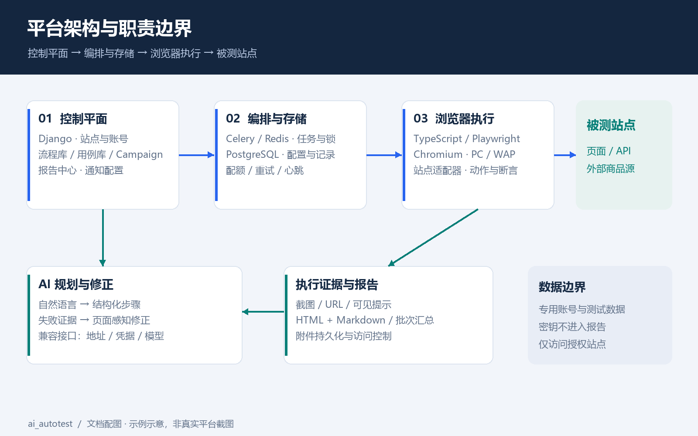
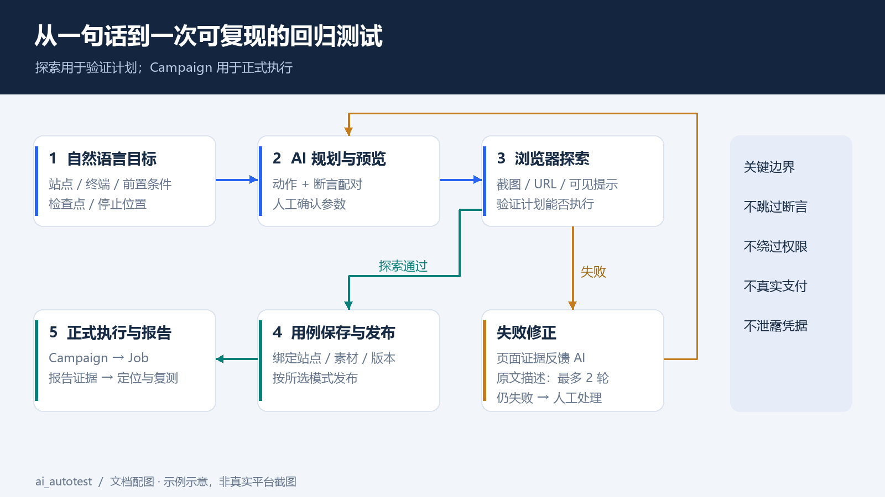
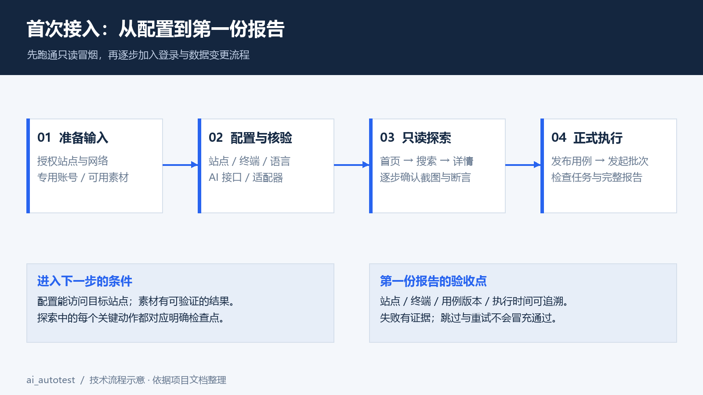
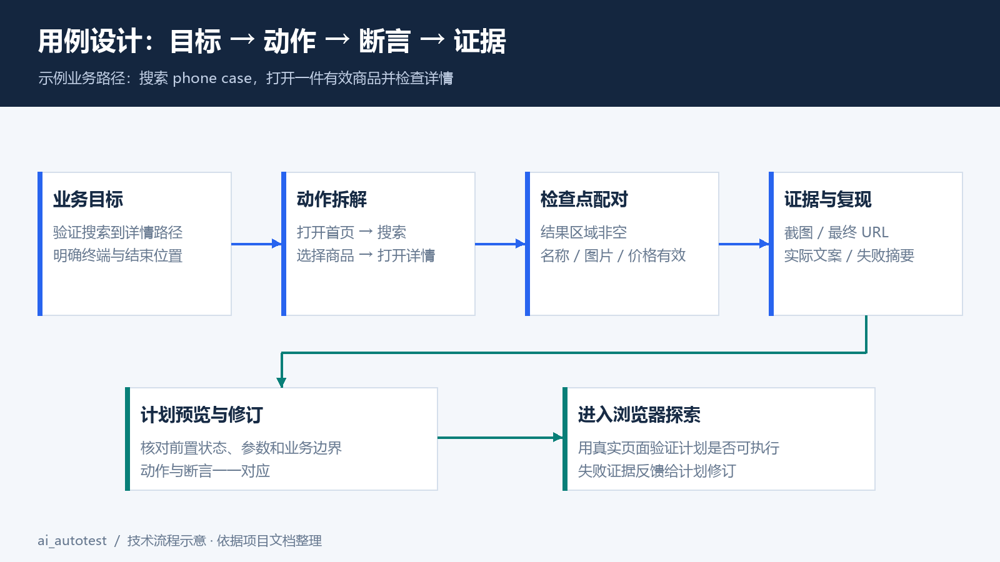
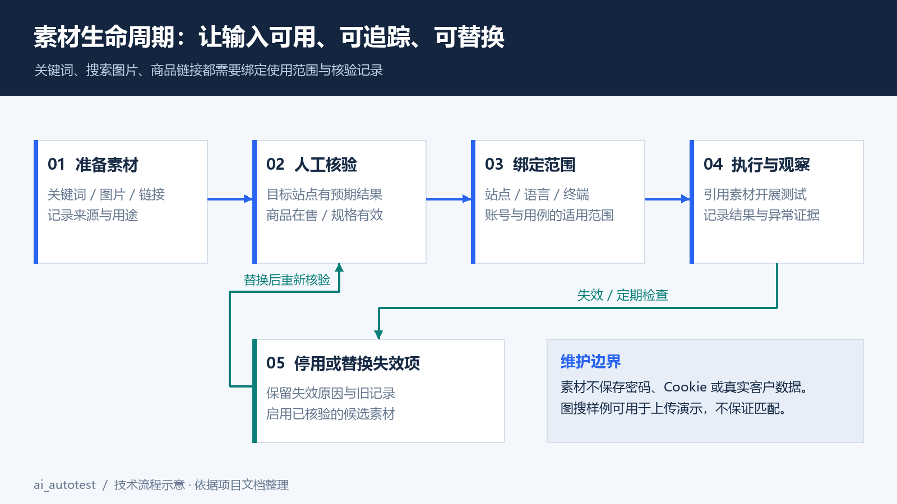
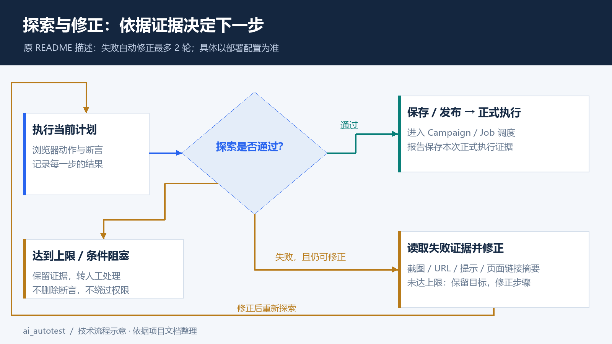
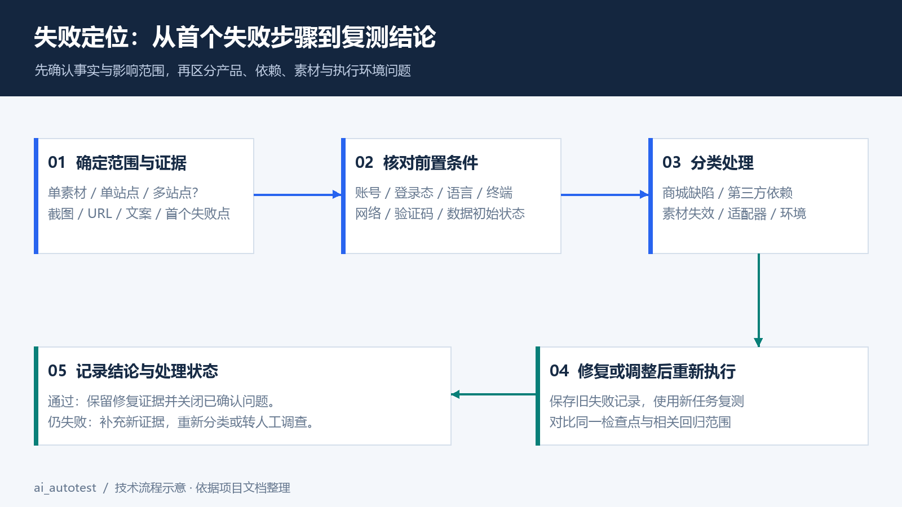

# ai_autotest · AI 驱动的网站自动化测试中心

> 用一句话描述测试目标，通过 AI 规划、真实浏览器探索和执行报告，把网站回归测试组织成可复用的用例。
>
> **适用读者**：测试人员、项目负责人及维护测试中心的工程师。已部署平台的用户可直接跳到[首次使用](#首次使用从一个冒烟用例开始)。


平台截图：
1.控制台-执行中心

2.测试启动台

3.测试用例库

4.ai生成测试用例
生成中：

生成计划并可以人工查看和修补


## 阅读说明与版本边界

本文根据用户提供的 `README (2).md` 和 `web-Playwright黑盒自动化测试部署方案.md` 扩充，整理日期为 **2026-11-05**。

| 信息类型 | 本文处理方式 |
|---|---|
| 测试中心能力 | 以原 README 描述的 Django 平台为准；未检查部署实例或项目源码 |
| 轻量执行器方案 | 作为建设背景、测试思路和独立执行参考，不与平台命令混用 |
| 技术配图与示例数据 | 配图仅解释架构与业务流程；示例数据不代表线上测量或验收结论 |
| 配置、用例与素材示例 | 使用虚构站点和演示数据；实际字段、动作枚举和导入格式以部署版本为准 |

**交付方式**：本文与 `docs/images/`、`examples/` 放在同一级目录。请一起复制或解压，图片使用相对路径引用。文件名按交付要求保留为 `redme.md`，放回仓库时可改名为 `README.md`。

## 项目简介

ai_autotest 面向电商及通用网站，通过网站公开界面执行黑盒测试，不要求取得被测网站的前后端源码。浏览器运行于服务器容器中，不占用操作人员的鼠标和键盘。

典型输入：

```text
使用已配置的专用测试账号登录，搜索“蓝牙耳机”，打开一件在售商品，
选择有效规格并加入购物车，确认购物车中出现该商品且数量为 1。
测试到此结束，不提交订单，不支付。
```

平台将自然语言转换为结构化计划，再用浏览器探索验证。探索结果提供截图、URL、可见提示及失败页面线索；失败步骤可反馈给 AI 修正，之后生成可调度的测试用例。

> 原 README 描述一键闭环会自动创建并发布用例，最多执行 2 轮失败修正。这是平台文档中的行为描述，并非本文对现网的验证结果。对会修改数据的流程，建议先使用预览编辑模式核对边界。

### 核心能力

| 模块 | 文档描述的能力 | 使用关注点 |
|---|---|---|
| 多站点管理 | 站点档案、路径表、PC/WAP 域名、账号、适配器 | 不同页面结构需适配；新域名不代表可直接复用全部动作 |
| 流程库与用例库 | `doc_steps` 结构化步骤、草稿/审核/发布/停用、版本管理 | 修改后重新探索；保留版本与变更原因 |
| AI 建用例 | 自然语言规划、人工预览编辑、一键闭环 | 明确前置条件、检查点和停止位置 |
| AI 探索验证 | 真实浏览器逐步执行、截图取证、失败页面感知修正 | 探索成功后仍需正式执行验证 |
| Campaign / Job | 批次与任务调度、站点锁、限流、重试、心跳、取消 | 观察等待与运行状态，避免重复启动 |
| 报告中心 | HTML / Markdown 报告、步骤证据、批次汇总、筛选 | 通过结论应有断言证据，不能只看页面打开成功 |
| 动作配方 | 探索沉淀候选配方，人工核准后进入规划词汇表 | 配方核准需要确认定位、作用范围与副作用 |
| 通知与配额 | 通用 webhook、逐任务或失败或汇总通知、站点配额 | 通知中的链接与数据应遵守报告访问权限 |

### 从轻量执行器到测试中心

| 维度 | 初始部署方案 | 测试中心 README |
|---|---|---|
| 入口 | 命令行、Cron | Django 管理界面、AI 建用例、Campaign |
| 调度 | `docker compose run`、宿主机锁 | Celery / Redis、任务模型、站点锁与配额 |
| 数据 | JSON 配置、输出目录 | PostgreSQL、站点与用例持久化 |
| 报告 | Playwright HTML / JUnit / JSON，失败附件 | HTML / Markdown、报告中心、批次汇总 |
| 运行环境 | Node.js / TypeScript / Chromium 容器 | Python 控制平面与 TypeScript 执行器协作 |

原方案中“不部署 PostgreSQL、Redis”仅适用于轻量阶段。测试中心按原 README 已引入这些服务。JUnit、JSON、视频和 Trace 属于原执行器方案的产物，是否已接入平台界面需要检查实际配置，不能默认全部可在报告中心查看。

## 架构与执行流程

### 架构职责

| 层级 | 主要组成 | 负责什么 |
|---|---|---|
| 控制平面 | Django、站点库、流程与用例库、报告中心 | 管理配置、接收测试目标、展示结果 |
| 编排与存储 | Celery、Redis、PostgreSQL | 分发任务、协调站点锁、保存任务和用例数据 |
| 浏览器执行 | TypeScript、Playwright、Chromium、适配器 | 访问站点、执行动作、检查断言、生成证据 |
| AI 服务 | OpenAI 兼容协议接口 | 规划步骤、结合失败证据提出修正 |

AI 接口参数包括 `base_url`、`api_key` 和 `model`，原 README 描述为数据库配置。截图、视频、报告等文件的真实挂载位置需查看部署编排，数据库备份不能替代文件备份。

### 端到端流程



1. **配置站点**：确认域名、路径、账号、适配器和测试数据。
2. **生成计划**：输入测试目标，检查动作与断言是否配对。
3. **探索验证**：执行浏览器探索，读取失败证据；允许范围内进行 AI 修正。
4. **生成并发布用例**：确认步骤、版本和作用范围；自动发布行为取决于所选模式。
5. **正式执行并查看报告**：发起 Campaign，跟踪 Job，依据截图和断言判断结果。

**三个对象不要混淆**：计划说明“准备怎样测”；探索结果说明“这次试走发生了什么”；正式报告说明“某次调度执行得到了什么结果”。探索通过不等于未来每次执行都通过。

## 首次使用：从一个冒烟用例开始

第一次接入建议先做“打开首页 → 搜索 → 验证结果”的只读流程。确认稳定后再加入登录、购物车等数据写入动作。



<!-- 真实截图位置：平台首页或仪表盘。截图后保存为 docs/screenshots/dashboard.png，再添加 Markdown 图片引用。 -->

### 接入前检查

| 检查项 | 需要准备的内容 | 完成标志 |
|---|---|---|
| 网络 | 执行容器能访问站点、图片和必要 API | 容器内浏览器能加载目标页面 |
| 站点 | ID、PC/WAP 域名、默认语言、币种、关键路径 | 站点档案保存且启用 |
| 账号 | 与探索、正式执行相匹配的专用账号 | 能登录且权限符合测试范围 |
| AI | 可用的兼容接口地址、密钥、模型 | 一次简单规划能得到有效步骤 |
| 素材 | 可搜索关键词、可用商品链接或搜索图片 | 在目标站点人工确认有效 |

### 五步完成首次运行

1. 在“站点管理”添加站点，核对域名、路径表与适配器；不要把平台访问地址当作被测站点地址。
2. 在“AI 接入设置”保存接口参数并启用，密钥只在配置界面或受控凭据系统中填写。
3. 在“AI 建用例”输入下方只读示例，先预览步骤，确保每个关键动作后有明确检查点。
4. 执行探索，检查每步状态、截图和最终 URL。失败时先读证据，再决定编辑步骤或重新规划。
5. 保存并发布用例，选择站点和终端发起 Campaign，进入报告中心打开对应 Job 报告。

```text
在已配置的 web 演示站点上，以英文桌面端访问首页，
确认搜索框可见且可输入，搜索“phone case”，
确认结果区域加载完成且至少出现一个商品，打开首个在售商品，
确认商品名称、图片和有效价格可见。
不登录、不加购物车、不创建账号、不提交订单。
如果没有在售商品或页面加载失败，保留失败证据，不跳过检查。
```

**首次运行验收**：报告包含目标站点、终端、时间、用例/任务标识以及关键步骤证据；若刻意输入不存在的元素或不可用素材，用例应失败并留下证据，不能把跳过当作通过。故障注入只在测试环境中进行。

## AI 建用例：把目标写得可验证



<!-- 真实截图位置：AI 建用例输入页或步骤预览页。建议保存为 docs/screenshots/ai-create.png。 -->

### 推荐描述模板

```text
测试目标：验证【业务路径】。
站点与终端：【站点 ID】、【PC/WAP】、【语言】、【币种】。
前置条件：【已登录/未登录】；使用【专用账号类别】与【素材名称】。
操作范围：【起点】→【主要动作】→【停止位置】。
检查点：【可见元素/URL/数量/单位/价格或提示】。
失败处理：保留截图和实际结果；不跳过失败断言。
禁止动作：【支付、充值、删除、真实下单等】。
```

“帮我测一下购物车”缺少前置条件与验收标准。更完整的描述是“专用账号登录后，把指定商品的有效规格加入购物车，验证名称、规格和数量为 1；结束于购物车页面”。

### 实例 A：搜索与商品详情（只读冒烟）

| 项目 | 示例 |
|---|---|
| 用例编号 | `DEMO-SMOKE-001`，仅用于本文示例 |
| 目标 | 验证搜索结果可以进入有效商品详情 |
| 前置条件 | 首页可访问，关键词已有有效结果 |
| 素材 | `examples/materials.csv` 中的 `keyword-001` |
| 终端 | 先 PC，再单独增加 WAP 运行 |
| 结束位置 | 商品详情页，不执行购物车或订单动作 |

| 步骤 | 动作 | 必须检查的结果 | 证据 |
|---|---|---|---|
| 01 | 访问首页 | 页面主体与搜索框可见 | 页面截图、URL |
| 02 | 输入 `phone case` 并搜索 | 输入值正确，结果加载完成 | 结果页截图 |
| 03 | 检查搜索结果 | 至少一个有效商品；空态不能当通过 | 商品列表或空态截图 |
| 04 | 打开有效商品 | 进入正确的商品详情路径 | 最终 URL |
| 05 | 检查商品信息 | 名称、图片、价格有效；不能一直加载 | 详情页截图与实际文案 |

以上为业务步骤说明，**不是平台 `doc_steps` 的可直接导入 JSON**。未取得项目动作枚举与参数定义，因此不编造执行器协议。实际步骤请在预览界面生成后，使用平台支持的导出格式保存。

### 实例 B：购物车（需要专用账号）

```text
在测试环境使用配置好的专用测试账号登录，搜索“蓝牙耳机”，
从有效搜索结果打开一件有库存的商品，选择一组可购买规格，数量设为 1，
加入购物车并进入购物车，检查商品名称、规格与数量和所选内容一致。
如果商品缺货、需要验证码或加入购物车失败，保留证据并停止。
不提交订单、不支付、不充值、不修改账户资料。
```

开始前记录购物车初始状态，避免已有同款商品导致数量从 1 累加为 2。清理时仅移除本次测试新增项目；清理动作也必须在测试账号和授权范围内。探索可能已经加购，因此正式执行前需重新检查初始状态。

### 实例 C：运费单位与语言一致性

```text
以英文桌面端打开运费估算页面，记录重量输入框标签与单位提示。
按照页面声明的单位输入等价于 1000 g 的重量，以及 20 × 15 × 10 cm 的尺寸，
选择 United States 后计算，检查出现有效结果或明确的业务提示。
若标签为 kg、提示为 g 且无法确定换算规则，记录单位不一致并停止输入，
不要自行猜测单位。记录实际文案、截图与 URL，不创建物流订单。
```

原方案列出的中英文混用、重量单位不一致、商品价格为零等问题在本文中作为**回归检查方向**，不表示它们今天仍然存在。零价格也应结合商品业务规则判断；常规付费商品与合法赠品需要不同断言。

## 素材池与演示素材



<!-- 真实截图位置：关键词、图片、链接素材池。建议保存为 docs/screenshots/library-pool.png。 -->

| 类型 | 演示文件/内容 | 用法与限制 |
|---|---|---|
| 搜索关键词 | `phone case`、`蓝牙耳机` | 选择目标站点实际有结果的关键词 |
| 搜索图片 | [search-sample.png](docs/images/search-sample.png) | 人工绘制的手机壳图；可演示上传流程，不保证图搜能匹配商品 |
| 商品链接 | `https://shop.example.com/demo/product-001` | 虚构占位地址，执行前替换成目标站点允许访问的有效链接 |
| 素材台账 | [materials.csv](examples/materials.csv) | UTF-8 CSV，共 5 条教学记录；不承诺符合平台批量导入接口 |
| 独立执行器配置 | [sites.example.json](examples/sites.example.json) | 基于原方案的字段示例，默认 `enabled: false`；不是 Django 站点导入格式 |


### 维护约定

1. **绑定站点**：每份素材注明适用站点、语言和终端，避免多个站点共用失效链接。
2. **执行前核对**：确认商品在售、可选规格有效、关键词有预期结果，保留替代素材。
3. **记录变更**：素材失效时停用旧记录，写明原因和替代项；不要通过放宽断言掩盖失效。
4. **隔离数据**：探索账号与正式测试数据按平台能力隔离，素材内不保存密码、Token 或真实客户信息。
5. **定期检查**：第三方商品链接至少每月核对一次，发布前回归再检查一次关键素材。

## 探索结果与自动修正



<!-- 真实截图位置：探索详情、逐步截图与修正轮次。建议保存为 docs/screenshots/explore-detail.png。 -->

### 探索详情重点看什么

| 证据 | 要回答的问题 |
|---|---|
| 步骤动作与参数 | 是否操作了正确的页面、商品、数量和规格？ |
| 截图与可见提示 | 是定位失败、权限限制、缺货，还是业务本身失败？ |
| 预期 URL 与实际 URL | 是否发生登录跳转、语言跳转、第三方跳转或错误页？ |
| 失败页链接摘要 | 目标入口是否存在，AI 修正是否依据当前页面？ |
| 修正轮次 | 本轮改变了什么，是否已经达到配置上限？ |

AI 修正应调整路径、定位或参数来满足原目标，不应删除关键断言、忽略错误或跨过权限限制。达到上限仍失败时，应保留当前证据，由人工核对站点、素材和适配器。

**验证码处理**：使用测试环境白名单或专用测试通道；若未提供这些条件，记录阻塞，不尝试绕过验证码。

## 发起 Campaign 与管理执行

Campaign 表示一次测试批次；Job 表示该批次中的执行任务。实际拆分粒度和状态名称以部署版本为准。

1. 选择已经发布的用例和目标站点，确认 PC/WAP、语言、币种与素材范围。
2. 检查测试账号和初始数据，尤其是购物车数量、登录状态与测试订单标记。
3. 发起批次，观察任务是否排队、获得站点锁并持续更新心跳。
4. 运行异常时先查看失败步骤和执行日志；取消后确认浏览器任务实际停止，再决定重跑。
5. 查看汇总与单任务报告，把需要处理的失败转为可复现的问题记录。

站点锁可能使探索和正式任务互相等待，这是保护同站点执行的一部分。重试会增加访问量，且可能重复执行数据写入动作；对于加购、注册等流程应核查幂等性和清理策略。

## 报告中心与故障定位



<!-- 真实截图位置：报告中心与一份脱敏任务报告。建议保存为 docs/screenshots/report-center.png。 -->

原 README 描述每次执行生成 **HTML 与 Markdown 双件套**，包含截图和逐步复现信息，并提供 Campaign 汇总。报告中心可按关键字、类别、站点和时间筛选。

### 示例报告摘录

> 以下全部是编写的教学数据，不是本次运行结果。

```text
批次：DEMO-CAMPAIGN-001
站点：web-demo | 终端：PC | 语言：en | 币种：USD
用例：DEMO-SMOKE-001 | 用例版本：示例 v1
结果：失败 | 通过检查点：3/5
失败位置：步骤 04，打开商品详情
预期：商品详情主体可见
实际：等待 60 秒后仍显示加载占位
证据：失败截图、最终 URL、可见文案、错误摘要
初步分类：待确认，可能涉及第三方商品源或商城详情加载
下一步：使用另一条已人工验证的素材复测，并对照网络错误
```

### 推荐排查顺序

1. **确定范围**：是单个素材失败、单站点失败，还是多个站点同时失败？
2. **读取证据**：对照截图、URL、实际文案、超时和浏览器错误，先找到首个失败步骤。
3. **验证前置条件**：检查账号、商品库存、验证码、语言、币种与站点网络。
4. **分类处理**：区分商城缺陷、第三方依赖、素材失效、适配器问题与执行环境问题。
5. **记录与复测**：保存原失败证据，修改配置或用例后发起新任务，不能覆盖原结论。

curl 复现适合描述单个 HTTP 请求，不能完整代表浏览器会话、前端状态和多步骤流程。复现材料必须脱敏；不要把 Cookie、Authorization、密码或收货地址直接放进报告。

### 缺陷记录模板

```text
标题：[站点][终端] 简短描述首个可复现失败
环境：站点、语言、币种、终端、执行时间及其时区
关联：Campaign / Job / 用例与版本 / 素材记录
前置条件：账号类别、登录状态、初始测试数据
复现步骤：最短有效路径
预期结果：明确的业务检查点
实际结果：截图、URL、错误文案与脱敏日志
复现情况：首次结果、重试结果、影响范围
判断：已确认事实与待验证推测分开记录
```

## 部署与日常运维参考

本节用于维护已存在的项目，不提供完整仓库或一键部署程序。命令依据原 README 整理，**本文未在服务器上执行**。先核对实际目录、Compose 服务名、环境变量与挂载卷。

### 测试中心目录

```text
ai_autotest/
├── control-plane/             # Django 控制平面
│   ├── apps/
│   │   ├── sites/             # 站点、账号、域名与配额
│   │   ├── scenarios/         # 流程、AI 规划、探索与动作配方
│   │   ├── campaigns/         # 批次、任务与执行记录
│   │   └── reports/           # 报告中心
│   ├── templates/
│   └── scripts/
├── django/                    # 平台部署层
│   ├── docker-compose.yml
│   ├── docker/
│   ├── policy-packs/
│   ├── skill-packs/
│   └── tools/
├── web-blackbox/               # TypeScript / Playwright 执行器
│   ├── tests/helpers/          # docflow 动作原语
│   ├── scripts/
│   └── config/
└── docs/images/                # 文档图片
```

### 平台部署命令参考

以下为 Linux Bash 命令。已有部署不必重复初始化；数据库变更或重启应按项目维护流程执行。

```bash
# 在 ai_autotest 仓库根目录检查模板；已有配置不要直接覆盖
test -f web-blackbox/config/sites.example.json
test -f django/docker-compose.yml

# 首次部署且 sites.json 不存在时，复制仓库自己的配置模板
if [ ! -f web-blackbox/config/sites.json ]; then
  cp web-blackbox/config/sites.example.json web-blackbox/config/sites.json
fi

# 先按实际环境补齐配置和密码，再进入部署目录
cd django
docker compose config --quiet
docker compose up -d

# 首次初始化；已有数据库先核查迁移计划与备份
docker compose exec web python manage.py migrate
docker compose exec web python manage.py createsuperuser
```

原 README 使用 nginx 默认端口 `3008`；实际以 Compose 的端口映射、反向代理和访问控制配置为准。示例中的 `examples/sites.example.json` 属于轻量执行器，不能替换平台仓库自己的模板。

### 只读检查

```bash
# 在平台 django 目录执行，服务名按实际编排调整
docker compose ps
docker compose logs --tail=100 web browser-worker scheduler report-worker
docker compose exec web python manage.py showmigrations
df -h
```

原 README 的服务构成为 `web / browser-worker / scheduler / report-worker / redis / postgres / nginx`。日志可能含业务数据和接口信息，对外提供前需要脱敏。

### 轻量执行器单独运行参考

仅当你仍保留原方案的独立 `/opt/web-blackbox` 项目，且其中存在 `playwright-test` 服务时，使用以下命令。它不是 Django 平台的服务名。

```bash
cd /opt/web-blackbox
docker compose run --rm playwright-test

# 覆盖容器内站点筛选变量时显式传入 -e
docker compose run --rm -e TEST_SITE_IDS=web-demo playwright-test

# 查看原生报告：在有依赖的独立执行器项目内运行
npx playwright show-report output/html-report
```

不要仅在宿主机前置 `TEST_SITE_IDS=...` 就假定变量一定进入容器；是否生效取决于 Compose 的变量传递方式。宿主机 `.env` 的插值与容器进程环境也应分别核对。

### 维护重点

| 事项 | 维护要求 |
|---|---|
| 版本 | Playwright 包与浏览器镜像标签按项目锁定版本匹配，升级后复测 PC/WAP |
| 并发 | 从小并发验证站点承载，再按实测调整；探索与正式任务遵守站点锁 |
| 报告空间 | 按容量和调查需求制定保留周期，例如 30 天；清理前核对持久化挂载 |
| 备份恢复 | 同时考虑数据库、配置与报告附件；恢复后检查报告链接和权限 |
| 定时调度 | 平台调度与旧 Cron 避免重复覆盖同一批次，核对调度器时区 |

## 常见问题

| 现象 | 优先检查 | 处理方向 |
|---|---|---|
| AI 无法生成计划 | 接口地址、凭据、模型权限、网络、返回格式 | 查看脱敏错误；先验证一次最小规划 |
| 一直排队 | worker 在线情况、站点锁、并发配额、心跳 | 核对持锁任务；不要直接删除锁来强行并发 |
| 本地能打开，容器失败 | DNS、TLS、代理、网络出口、依赖资源 | 从执行环境复现；保留证书或请求错误 |
| 找不到搜索/登录入口 | 语言、视口、登录态、适配器与路径 | 修正定位或页面路径，不删除关键检查 |
| 探索通过，正式执行失败 | 数据初始状态、素材时效、账号隔离、时序 | 比较两次截图、步骤版本与素材 |
| 加购数量不对 | 已有购物车、重复探索、重试副作用 | 隔离测试数据，核对初始数量与清理结果 |
| 报告打不开或图片丢失 | report-worker、挂载、反向代理、鉴权 | 核对文件是否生成及实际资源路径 |
| 失败但显示为成功 | 断言缺失、异常被吞、重试/跳过统计 | 保留非零执行状态，分别展示通过、失败、跳过 |
| 商品链接突然失效 | 第三方下架、规格变化、权限限制 | 停用失效素材，换已核验候选并重新探索 |
| 移动端偶发点不中 | 遮挡、浮层、滚动、适配器与视口 | 截图定位实际遮挡，不依赖固定坐标强点 |

## 数据与执行边界

测试中心会真实访问目标站点，探索也可能产生业务数据。测试范围应使用授权的站点、专用账号和可清理的素材。

| 边界 | 实施要求 |
|---|---|
| 账号 | 不使用管理员、财务或真实客户账号；不绑定真实支付方式 |
| 数据变更 | 注册、加购、下单等分别设置允许范围；支付和充值不纳入本文示例 |
| 凭据 | 密码、API 密钥、登录态不进入 Git、截图示例、公开报告或通知正文 |
| 报告访问 | 认证、受控网络或访问策略；附件和静态资源同样需要保护 |
| AI 数据 | 上传前清除敏感字段，按实际需要提供脱敏截图与 DOM 摘要 |

原方案提到 `ALLOW_MUTATING_TESTS=false` 作为可采用的显式开关示例；只有代码实际读取并执行拦截时才有效。不要因为设置了同名变量就认为平台已经禁止所有写操作。

## 验收清单

1. **基础运行**：平台可登录，服务运行正常，服务器容器中可启动 Chromium；无需桌面或 VNC。
2. **站点与用例**：站点、账号、AI 和素材已核对；只读示例可规划、探索、保存和正式执行。
3. **失败证据**：预期失败能被正确标记，截图、URL 与实际结果可查；重试和跳过不冒充通过。
4. **调度与报告**：Campaign / Job 可追踪，站点锁有效，HTML / Markdown 报告和附件可授权访问。
5. **运行维护**：敏感数据不泄露，定时任务不重复，文件持久化、容量检查与备份恢复有记录。


## License

项目许可证以实际仓库的 `LICENSE` 为准；本交付不推断或修改原项目的授权范围。
